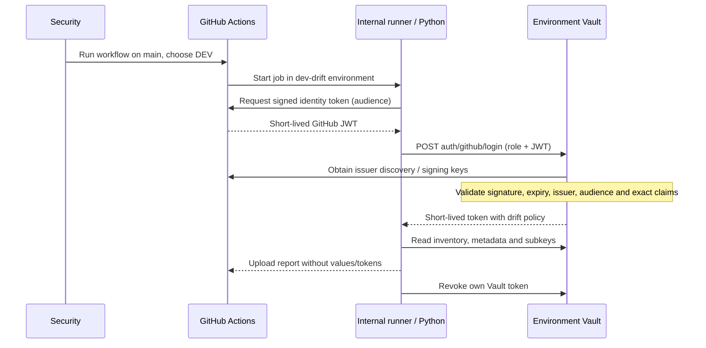

# Start here: GitHub OIDC and read-only Vault drift reporting

**First goal:** run a Python inventory against DEV from GitHub Actions using a short-lived Vault identity. Repeat for UAT/PROD, then compare the three reports. This is Workstream 2; it needs no Terraform, state bucket, application-server changes or secret seeding.

Use this guide to connect your existing environments. [OIDC-PILOT.md](OIDC-PILOT.md) reproduces the disposable demonstration; it does not configure your existing Vaults. [RUNBOOK.md](RUNBOOK.md) covers the broader promotion project for later.

**Want a working lab first? [LOCAL-LAB.md](LOCAL-LAB.md) creates three real TLS Vaults and generates reports from their APIs.** The [walkthrough](examples/REPORT-WALKTHROUGH.md) uses observed results and links actual GitHub OIDC evidence. Lab data/labels do not substitute for configuring your own endpoints/trust.

## 1. Find your way around the repository

| Open this | Purpose / when to use it |
| --- | --- |
| [`.github/workflows/vault-drift-onboarding.yml`](../.github/workflows/vault-drift-onboarding.yml) | **Start here in Actions:** `Vault drift - getting started`. Run one environment at a time: `claims`, `authenticate`, then `collect`. |
| [`environments/dev/settings.json`](environments/dev/settings.json) | Where DEV maps to its Vault HTTPS URL, JWT mount, audience, role and reporting settings. Equivalent files exist for UAT/PROD. |
| [`bootstrap/drift-policy.hcl`](bootstrap/drift-policy.hcl) | Vault administrator installs/reviews this inventory policy. Metadata/subkeys and configuration reads; no KV value reads. |
| [`bootstrap/github-drift-role.json.example`](bootstrap/github-drift-role.json.example) | Drift-specific JWT role template. Replace every placeholder with the organization's claims. |
| [`scripts/oidc-check.py`](scripts/oidc-check.py) | Small Python identity inspection/login test called by the onboarding workflow. |
| [`scripts/drift.py`](scripts/drift.py) / [`scripts/inventory.py`](scripts/inventory.py) | Collect and compare policy/configuration fingerprints, KV paths and nested field names. |
| [`.github/workflows/vault-drift.yml`](../.github/workflows/vault-drift.yml) | **After onboarding:** `Weekly Vault inventory and rotation`, collects all environments and assembles comparison/rotation artifacts. |
| [`scripts/rotation-report.py`](scripts/rotation-report.py) | Uses collected reports to summarize rotation dates; makes no second Vault connection. |
| [`examples/REPORT-WALKTHROUGH.md`](examples/REPORT-WALKTHROUGH.md) | Sample report and how to interpret findings. |
| [`INVENTORY.md`](INVENTORY.md) | Exact supported inventory, exclusions and exception handling. |
| [`SCRIPT-REFERENCE.md`](SCRIPT-REFERENCE.md) | Workflow-to-script map, dependencies, identities, outputs, side effects and exit codes. |

Leave `vault-admin-request`, `vault-admin-deploy`, `vault-restart-credentials`, `configuration/admin-setup` and backend files for Workstream 1. `vault-validate` runs synthetic regression tests. `vault-oidc-pilot` builds disposable Vaults and also exercises Terraform; it is optional evidence, not your first environment scan.

## 2. How authentication works



Vault enables the **JWT auth method** at the path `github`. It uses GitHub's OIDC discovery/signing keys; this is not a browser login or Vault's separate GitHub personal-access-token auth method. No OAuth client ID/secret or callback URL is required for this JWT flow. The runner handles temporary tokens in memory; no long-lived Vault token is stored in GitHub secrets. Human LDAP access continues separately.

## 3. Gather these settings and prepare the runner

| Owner | Required information / task |
| --- | --- |
| Repository administrator | Approved private repository with reviewed workflow changes on protected `main`; Actions enabled; authorized report readers. Use the full existing repo or copy Section 13 **and the root `.github/workflows`** preserving their paths. Workflows only appear for manual dispatch after they are on the default branch. |
| Repository administrator | Create GitHub **Environments** named `dev-drift`, `uat-drift`, `prod-drift` under Settings → Environments. Restrict them to `main`; agree reviewers if required. These are GitHub job environments, not Vault namespaces. |
| DevOps | Register an approved internal Linux self-hosted runner through Settings → Actions → Runners → New self-hosted runner, following the displayed instructions. Give it custom label `vault-demo`, or change `runs-on` in **both** drift workflows to the approved label. Limit its use to trusted repos/workflows. |
| DevOps | Install Git and Python **3.10+** on the runner. Python scripts use the standard library; no pip dependencies, Terraform CLI or Vault CLI are needed there. The Vault CLI is needed on the administrator's setup workstation for the commands below. |
| Vault administrator | Confirm Vault versions support KV v2 `subkeys`, each endpoint/port, CA chain, JWT mount path and the inventory policy scope. Community Edition uses separate Vault endpoints, no namespaces. |
| DevOps / network | Runner reaches GitHub/Actions checkout and artifact services plus the three Vault HTTPS endpoints. **Vault servers** must reach the configured issuer's discovery/JWKS endpoints. OIDC is not an inbound connection from GitHub to your Vault. |
| DevOps | Install the Vault CA into the runner's system trust, or configure `VAULT_CACERT` as an absolute readable PEM path in the runner service environment, then restart that service. Validate TLS; do not disable certificate checks. |
| Security | Agree report readers, rotation metadata name/threshold and known environment differences. Reports reveal path/field names and infrastructure inventory, so use the private repo's access controls. |

Confirm **GitHub.com / Enterprise Cloud versus Enterprise Server (GHES)**. Public GitHub normally uses issuer `https://token.actions.githubusercontent.com`; enterprise issuer customization or GHES changes this. Use the actual `iss` discovered below. GHES may require supported checkout/artifact action versions and an internal runner for the report job instead of `ubuntu-latest`; review compatibility before using these example workflows unchanged.

GitHub Desktop is not the GitHub CLI. **The GitHub CLI is optional**: every workflow below can be launched in the browser.

## 4. Inspect the actual GitHub identity first

This can run **before Vault JWT auth is configured**, using the internal runner. It does not connect to Vault and ignores placeholder Vault addresses.

1. Open the **target repository**, then Actions → **Vault drift - getting started** → Run workflow.
2. Select branch `main`, environment `dev`, step `claims`.
3. Wait for success. On the run's Summary page, download artifact `vault-onboarding-dev-claims` and open `dev-claims.json`.
4. Record `iss`, `aud`, `sub`, `repository`, `repository_id`, `repository_owner_id`, `ref`, `workflow_ref`, `event_name`. Only these selected non-secret claims are exported; the JWT is never exported. Decoding claims is diagnostic, not signature verification.

**Observed example:** [DEV claims reference and field mapping](examples/DEV-CLAIMS-REFERENCE.md) includes [the downloaded JSON](examples/github-dev-claims.json) from a successful demonstration-repo run. In the UI, the artifact is a ZIP; extract it to read `dev-claims.json`. Claims inspection succeeds without a real Vault endpoint and does not prove Vault authentication. After saving your own claims, continue to step 5, then run `authenticate` and `collect` after configuring the real endpoint and role.

Do not copy the public demonstration repository IDs or subject from older examples. GitHub subjects may use default, customized or immutable-ID formats. Use the **exact issued `sub`**, including any encoding. Repeat for UAT/PROD because the environment part changes.

If choosing a different audience from the example `vault-demo`, first set `oidc_audience` in each settings file through a reviewed change and rerun this step. The requested audience and Vault role's `bound_audiences` must match.

## 5. Enable JWT/OIDC trust in DEV Vault

The Vault administrator performs this once per environment, from an approved workstation using their existing administrative login. These commands change authentication/policy configuration; they do not create or modify application secrets.

From repository root:

```bash
export VAULT_ADDR='https://YOUR_DEV_VAULT:8200'
export VAULT_CACERT='/absolute/path/to/vault-ca.pem'
vault status
vault auth list
```

Log in using the approved administrative method if needed. Do not place the administrator's token in GitHub. If `github/` already exists, check its type and configuration and coordinate changes; **do not disable/recreate it or overwrite shared trust blindly**. The commands below assume a new `github/` JWT mount:

```bash
vault auth enable -path=github jwt
vault write auth/github/config \
  oidc_discovery_url='https://token.actions.githubusercontent.com' \
  bound_issuer='https://token.actions.githubusercontent.com'
vault policy write github-drift \
  13-Vault-Configuration-Promotion/bootstrap/drift-policy.hcl
```

Replace both issuer values with the reviewed actual issuer from step 4 when different. If the discovery endpoint uses an internal CA, configure the JWT backend's `oidc_discovery_ca_pem` separately; the runner's `VAULT_CACERT` only controls runner → Vault trust.

Review the policy before installation. It intentionally covers instance-wide supported inventory. `+` covers one path segment: add exact metadata/subkeys/config permissions for nested KV mount names such as `team/secret`. Review plugin-specific configuration read endpoints for the installed engines. Do not grant root, `sudo`, credential issuance or KV `data` access to make a denied scan green.

### Create the DEV drift role

Copy [`bootstrap/github-drift-role.json.example`](bootstrap/github-drift-role.json.example) to a temporary reviewed `dev-drift-role.json`, replacing all `CHANGE_ME` values:

| Role field | Value to use |
| --- | --- |
| `bound_audiences` | Actual requested `aud`; matches `settings.json` `oidc_audience`. |
| `repository`, `repository_id`, `repository_owner_id` | Values in `dev-claims.json` from the target repo. Keep all exact bindings. |
| `ref` | `refs/heads/main`. |
| `sub` | Exact DEV subject from the claims artifact for `dev-drift`. |
| `workflow_ref` | Allow only the two exact target workflow refs: onboarding and weekly drift, both `@refs/heads/main`. Replace the two placeholders with `OWNER/REPO/.github/workflows/vault-drift-onboarding.yml@refs/heads/main` and `OWNER/REPO/.github/workflows/vault-drift.yml@refs/heads/main`. |
| `event_name` | The template permits only `workflow_dispatch` and `schedule`. |
| `token_policies` | `github-drift`, the policy installed above; no default policy. |
| TTL | Template is 15 minutes. Agree sufficient TTL for inventory size; token renewal is not implemented. |

Review the completed JSON, then install it:

```bash
vault write auth/github/role/github-dev-drift @dev-drift-role.json
vault read auth/github/role/github-dev-drift
```

The role allows both reporting workflows, so the same scoped identity works for initial onboarding and later scheduling. List-valued bound claims accept one of the listed exact values; do not replace these with wildcard repository/workflow bindings.

## 6. Connect the environment names to Vault URLs

Edit **`13-Vault-Configuration-Promotion/environments/dev/settings.json`**, through the organization's reviewed Git process. Keep the rest of the schema for later Workstream 1, but set these fields:

```json
{
  "vault_addr": "https://YOUR_DEV_VAULT:8200",
  "jwt_auth_path": "github",
  "oidc_audience": "vault-demo",
  "drift_role": "github-dev-drift",
  "rotation_metadata_field": "password_cycle_date",
  "rotation_max_age_days": 90,
  "inventory_expected_fields": {},
  "inventory_resource_aliases": {},
  "inventory_comparison_exceptions": []
}
```

This is a **field-edit example, not a replacement for the full file**. Set the chosen audience/metadata/age; 90 days is an example. Clear the three inventory maps shown above initially: current files contain demonstration repo role expectations/aliases/exceptions for roles that you have not created. Later add reviewed environment expectations and narrowly justified aliases/exceptions to all affected environments. Starting empty reports real differences; it does not silently approve them.

The workflows pass `--env dev`; `common.settings()` opens this exact file. `VAULT_ADDR` on the runner does **not** override the script's `vault_addr`. `jwt_auth_path` excludes `auth/` and the trailing slash. No `namespace` field/header is needed. `--inventory-only` avoids the demo `release.yaml`, `application.json`, `expected_approle` and `expected_kv_config` baseline; configured `inventory_expected_fields` still applies.

## 7. Test the DEV login, then collect

Run **Vault drift - getting started** again on `main`, environment `dev`, step **`authenticate`**. Success produces `dev-authentication.json` with `authenticated: true` and an engine count. This proves the GitHub token was accepted by DEV Vault and the issued drift identity can read mount inventory. The token is revoked afterward; short TTL is the fallback. It does not establish full scan coverage or keys-only access by itself.

Then run step **`collect`**. Download `vault-onboarding-dev-collect` and open `dev.json`:

| Look at | Meaning |
| --- | --- |
| `baseline_mode: inventory_only` | No selected demo-application Git baseline was required. |
| `complete` | Whether supported inventory reads succeeded. `false` requires investigation; it is not equality. |
| `inventory.kv_paths` | Paths, nested field names, present/deleted status and rotation status. Values are not fetched. |
| `findings` | Missing/overdue/invalid/future rotation metadata, unknown reads, configured expectation differences. |
| `inventory.coverage.unsupported_details` | Explicit plugin/detail exclusions. A complete supported scan can still contain exclusions. |

Collection intentionally uploads findings without failing the single-environment onboarding job. **A green collection job means a report was produced**, not that there are no findings. Review `complete`, findings and coverage. Confirm the installed policy excludes KV value access; the synthetic regression suite verifies this policy on disposable Vaults. Do not test with or export real secret values.

Repeat steps 4–7 for `uat` and `prod`: configure each Vault separately, use role names `github-uat-drift` / `github-prod-drift`, use that environment's exact subject and endpoint, and follow the internal PROD change process.

## 8. Run the three-environment comparison

Only after all three environments collect successfully:

1. Settings → Secrets and variables → Actions → **Variables** → Repository variables: set **`VAULT_DRIFT_ENABLED` = `true`**.
2. Keep **`VAULT_AUTOMATION_ENABLED` = `false`** so enabling reports does not enable Terraform deployment or credential workflows.
3. Actions → **Weekly Vault inventory and rotation** → Run workflow → `main`.
4. Read the tables in Summary and download **`vault-drift-comparison`**, containing `report.md`, `comparison.json` and `rotation-report.json`. Individual `vault-drift-dev/uat/prod` artifacts contain collectors' output.

The report job runs on `ubuntu-latest` without any Vault identity or Vault network connection; it compares artifacts. Collection jobs use the internal runner. Artifacts are retained seven days by these workflows. Download/store approved evidence before expiry if longer retention is needed.

| Final report job exit | Interpretation |
| --- | --- |
| `0` | Supported scan complete; no reported findings. Review exclusions and approved exceptions too. |
| `2` | Reports saved; differences or rotation findings need Security review. This is an expected outcome for real environments. |
| `3` | Incomplete evidence, including missing environment reports or denied reads. Fix coverage/connectivity before concluding parity. |

The workflow uses inventory-only mode. `same_selected_release` and `all_policies_match_selected_git` are `null` because the demo-app Git baseline was not evaluated. Policy fingerprints still compare **between environments**. All-three-match does not prove compliance with an approved Git baseline; configure inventory expectations deliberately and tackle catalog-wide compliance separately.

Schedule is **Monday at 11:00 UTC once a week**, using `cron: '0 11 * * 1'`, active when the reporting switch is enabled. UTC stays fixed across local daylight-saving changes. To stop automated reports, set `VAULT_DRIFT_ENABLED=false` and ensure the legacy `VAULT_AUTOMATION_ENABLED` switch is also false. The manual onboarding workflow remains available to authorized users on main.

### Optional CLI or offline comparison

Run from repository root with the GitHub CLI installed/authenticated to the **target** repository:

```bash
gh workflow run vault-drift-onboarding.yml --ref main -f environment=dev -f step=claims
gh workflow run vault-drift-onboarding.yml --ref main -f environment=dev -f step=authenticate
gh workflow run vault-drift-onboarding.yml --ref main -f environment=dev -f step=collect
gh workflow run vault-drift.yml --ref main
gh run list --workflow vault-drift.yml --limit 5
```

To compare downloaded `dev.json`, `uat.json`, `prod.json` offline, no Vault login is required:

```bash
python3 13-Vault-Configuration-Promotion/scripts/drift.py \
  --compare /path/to/dev.json /path/to/uat.json /path/to/prod.json > comparison.json
python3 13-Vault-Configuration-Promotion/scripts/rotation-report.py \
  comparison.json > rotation-report.json
```

## 9. Troubleshooting

| Symptom | Check |
| --- | --- |
| Workflow missing / no Run workflow button | Workflow file is at root `.github/workflows`, reviewed on default `main`, Actions enabled, correct user permissions. |
| Job queued indefinitely | Runner online, assigned to repo/group, both `self-hosted` and `vault-demo` labels match. |
| Waiting for approval | Check the selected `ENV-drift` GitHub Environment protection rules. |
| Claims step fails | Python/Git on runner, checkout works, `id-token: write`, runner reaches GitHub token service. Do not print the full token to debug. |
| Authentication check fails | Correct HTTPS endpoint/CA, `github` JWT mount, role installed, issuer discovery reachable **from Vault**, audience and exact target claims. Inspect approved Vault operational/audit diagnostics without exporting tokens. |
| Authentication passes but collection is incomplete | Inspect `findings` paths/statuses. Review read/list permissions, nested mount rules, supported plugins and Vault `subkeys` support. |
| Extra/missing paths or field names | Check application name/rename history and approved ticket sequence. DEV ahead of UAT/PROD can be intentional. |
| Expected automation-role differences | Role names and `sub` vary by environment. Add explicit resource aliases and exact-field exceptions only after Security reviews the bindings; the same exception must appear in every compared environment to take effect. |
| Rotation `missing` | Security must populate the chosen custom metadata field with the actual rotation date; format `YYYY-MM-DD`. A write timestamp is not a rotation date. |
| Red comparison job with downloadable report | Exit 2 means findings; exit 3 means incomplete evidence. Read the saved artifact before treating it as a pipeline failure. |
| Scan expires / times out | Inventory size may exceed the 15-minute role TTL. Review runtime/TTL with Security; renewal is not implemented. |

## 10. Handoff acceptance

- [ ] Target repo, report readers, restricted main and runner owner recorded.
- [ ] DEV/UAT/PROD claims, issuer, endpoints and CA verified.
- [ ] Each Vault has reviewed JWT trust, exact workflow/repository/environment bindings and drift policy.
- [ ] All three authentication checks and collections complete; exclusions understood.
- [ ] Security can independently launch a run, download reports and classify findings.
- [ ] Rotation convention, expected differences and schedule agreed; reporting enabled independently of deployment.
- [ ] Splunk follow-up uses candidate paths plus available audit history and application-owner confirmation. No automatic cleanup. Verify available audit retention and archive coverage before making inactivity claims.

Next, use [RUNBOOK.md](RUNBOOK.md) for a one-application Workstream 1 pilot and protected remote state. That is a separate setup milestone.

Official references checked while preparing this guide: [GitHub → Vault OIDC setup](https://docs.github.com/en/actions/how-tos/secure-your-work/security-harden-deployments/oidc-in-hashicorp-vault), [GitHub issuer/subject claims](https://docs.github.com/en/actions/reference/security/oidc), [Vault JWT configuration and role API](https://developer.hashicorp.com/vault/api-docs/auth/jwt).
